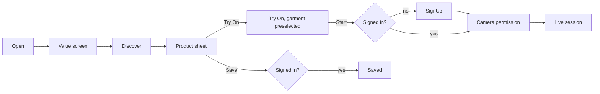

# User Flows — current vs proposed

Problems are tagged: **DE** dead end · **RS** redundant step · **DS** duplicate screen · **FA** forced/premature account · **AB** ambiguous button · **LC** lost context · **CL** confusing loading · **MF** missing feedback · **BB** broken back · **RU** repeated upload · **DF** disconnected feature.

## A. First-time shopper
**Current:** `/` IntroCarousel → sign up or "continue as guest" (sets localStorage flag) → bottom nav (Feed/Explore/UGC/Profile) → Feed = `/swipe` → product → try on? *No Try On on the product.* Try-on only via AiStudioModal from Swipe header/Profile → upload garment again → picture result.
Problems: FA (UGC and Profile tabs show "Create an account" toast), DF (product and try-on not connected), RU (garment re-upload), AB ("UGC" label), LC (nav auto-hides after 2 s).

**Proposed:** open app → short value screen (3 pillars, one tap "Start exploring") → Discover For You (public, no account) → product sheet → **Try On** → Try On screen with garment preselected → "Start live try-on" → account prompt *here* (first point where an account is truly needed) → camera explainer → session.

## B. Returning shopper
**Current:** opens to `/dashboard` → redirected to `/profile` (a dashboard of carousels). Must tap Feed to browse.
**Proposed:** opens to Discover For You (personalised by taste profile), last tab remembered. Problems fixed: RS (dashboard hop), LC.

## C. Community creator
**Current:** posts: Profile → "Create post" (CreateStyleLinkPostModal). Outfits: Dress Me (not in nav for most users; reached from Profile/Community buttons) → wardrobe → canvas → save → publish toggle → appears in `/dress-me/community` *and* `/community`. FashionFeed (posts) is unreachable. Problems: DS (3 feeds), DF (posts and outfits never shown together), DE (`/forum`, `/feed`).
**Proposed:** Community → **Create** → Post | Outfit → (canvas, unchanged) → preview → visibility (Public / Only me, default Only me for outfits) → publish → lands on the new item in the feed.

## D. Globe discovery
**Current:** Explore tab → Brands tab default → tap country → brand drawer. Shoppers tab: counts wrong (RLS, see SUPABASE_AUDIT). Following/Your Fit/Deals tabs open full-screen drawers and blank the globe. "Home" goes to Profile, "Skip to Feed" goes to Swipe. Problems: AB, DE, BB, MF (wrong counts).
**Proposed:** Discover › Globe → choose People / Outfits / Brands (segmented control) → tap country → sheet with cards → Follow / View outfit / Shop brand / Try On. Back closes the sheet, then returns to the previous Discover mode.

## E. Real-time fitting
**Current:** Swipe → AI Studio button → modal → "Live" tab (shoppers only) → pick from wardrobe / 12 arbitrary products / 12 event items → Start → warm-up (up to minutes on cold start) → session → swap → stop. Problems: DF, RU, CL (cold start), hidden for non-shoppers.
**Proposed:** any product/outfit → Try On (preselected) → Start → clear warm-up states ("Connecting", "Starting GPU — first start can take a few minutes", "Ready") with Cancel → live → garment tray swap (uses the existing mid-session `set_reference_image` / `set_prompt`) → Snapshot / Share / Stop. Denied camera → explain + Photo mode. GPU unavailable → "Try again" + Photo mode.

## F. Brand onboarding
**Current:** sign up with role "brand" (metadata) → `/brand-portal` → BrandOnboardingModal → category selector → products (manual or import) → products appear in discovery immediately (no review). Problems: no verification (S9), cluttered portal (Collabs, Services, Portfolio, Salon).
**Proposed:** sign up as business → business details → **pending verification** (can prepare products, cannot publish) → approved → Partner Workspace → Products → Try-On readiness check (image on white, ≥ 768 px, garment type) → Publish.

## G. Pop-up operator
**Current:** none. Closest: retailer creates event → adds brands and event products → shoppers use `/events` (photo try-on) or AR via QR.
**Proposed:** see KIOSK_MVP.md — Partner › Events › Kiosk → choose approved collection → "Warm up stand" (starts GPU worker) → open `/kiosk/:standId` on the stand device → readiness checklist (camera, GPU, network) → Attract mode.

## H. Pop-up customer
**Proposed:** attract loop showing the collection → "Tap to try on" → clear camera notice + "Start" → live session (single person) → swap garments on big buttons → End → optional QR to receive snapshot (separate consent) → auto-reset after 60 s idle, all frames discarded.

## I. Existing user upgrade
Accounts, roles (`user_roles`), likes, wardrobe, fits, posts, credits and subscriptions are untouched. Old URLs redirect (INFORMATION_ARCHITECTURE.md). Brands/retailers land in `/partner` instead of the old portals. With 8 accounts today, every account can be spot-checked by hand after release.
